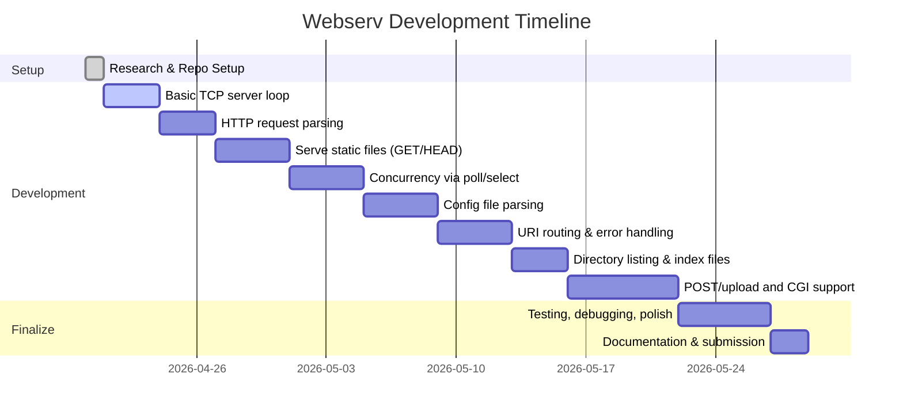

# Executive Summary  
The **webserv** project (42 School) tasks you with building a custom HTTP/1.1 web server in C++98.  In essence, you will write a *non-blocking*, poll-driven server that can parse HTTP requests from clients (browsers, `curl`, etc.) and serve static or dynamic content.  The mandatory requirements include reading a configuration file (Nginx‐like syntax) to determine listening ports, server routes and defaults, handling GET/POST/DELETE requests, serving files (with directory indexes or autoindexing), supporting file uploads, executing CGI scripts, and returning proper HTTP responses (including error pages).  Crucially, **all I/O must be non-blocking with a single `poll()` (or `select()`/`epoll()`) loop**, and the server must never crash or hang.  You must submit a compliant Makefile and README, and abide by the strict C++98/no-Boost rules.  

In our report we first summarize the project’s goals, features and grading criteria (from the official subject)【9†L299-L310】【32†L506-L513】.  Then we outline the key technical skills and C/C++ concepts to master (e.g. BSD sockets, HTTP semantics, event loops, parsing, CGI, etc.), and list authoritative resources (RFCs, MDN, tutorials like Beej’s Guide, cppreference, etc.)【17†L201-L209】【20†L18-L26】【32†L506-L513】.  We recommend a clean directory layout with `src/`, `include/`, `tests/`, etc., plus a sample Makefile and minimal bootstrap code (shown below).  A phased development plan is provided, with a Mermaid Gantt chart of milestones.  We also list common pitfalls (e.g. forgetting to set non-blocking mode, mis‐handling `poll()`/`epoll()`, incorrectly parsing HTTP, not closing connections, memory leaks, etc.) and a final pre-submit checklist (compiles with `-std=c++98 -Wall -Wextra -Werror`, correct README, config examples present, all required HTTP behaviors implemented, etc.).  By following this guide and the cited resources, you’ll be well-prepared to tackle Webserv.

## 1. Project Goals and Requirements
According to the official subject, **Webserv** is about “writing your own HTTP server”【9†L295-L303】.  The primary goal is to implement an **HTTP/1.1 server** (text-based protocol over TCP) that listens on one or more IP:port endpoints, parses incoming HTTP requests (methods, headers, body), and sends correct HTTP responses.  Key **mandatory features** (subject IV.1–IV.3) include:  

- **Configuration File** (Nginx-like): Your program must read a config file (argument or default path) that defines virtual servers.  For each “server” and its “location” blocks, you must support directives for listen ports, root directory, index files, error pages, `client_max_body_size`, allowed methods, HTTP redirections, directory listing on/off, upload directory (`upload_store`), CGI executables (by extension), etc.【9†L325-L334】【32†L581-L589】.  At least one `server` block is required, and within it one or more `location` blocks.  This config is parsed at startup and stored in data structures for request handling【9†L299-L303】【9†L325-L334】.  

- **HTTP Protocol (1.1)**: The server must fully comply with HTTP/1.1 syntax and semantics (as per IETF RFCs 7230/7231).  You need to parse request lines and headers (CRLF line endings, case-insensitive header names), support persistent connections (unless `Connection: close` or error), and form valid HTTP responses.  Basic status codes (200, 301, 404, 413, 500, 501, etc.) are required.  Support for **GET**, **POST**, and **DELETE** is mandatory – any other method should return `501 Not Implemented`【32†L519-L526】.  For GET, serve the requested file (or directory index, or return 404 if not found).  For POST, allow file uploads or CGI processing.  Parse `Content-Length` and **chunked transfer encoding** (unchunk before handing to CGI)【32†L550-L558】.  The Mozilla MDN HTTP documentation is a great reference for protocol details【32†L506-L513】.  

- **Concurrency & Non-blocking I/O**: The server must be *event-driven*, using **one** `poll()` (or `select()`/`epoll()`) loop for *all* connections【32†L482-L490】.  This means all sockets (listening and client sockets) must be non-blocking, and *no thread or process per client*.  You cannot use multiple `poll()` calls or spawn worker threads/processes; the entire I/O multiplexing happens in one loop【32†L482-L490】【22†L38-L42】.  Also, you must not call `fork()` except when executing a CGI script (the subject explicitly forbids fork elsewhere).  The event loop should accept new connections and read/write data on sockets as they become ready【32†L482-L490】【22†L38-L42】.  If any socket operation would block (e.g. reading from a socket with no data), you must leave it to the poll mechanism.  Failing to use non-blocking I/O or calling read/write on a socket that isn’t ready will result in disqualification【32†L482-L490】【22†L38-L42】.  

- **CGI and Uploads**: Execute external CGI scripts (e.g. Python, PHP) for dynamic content, keyed by file extension (e.g. `.php`).  Set up the proper environment variables and pipe data between webserv and the CGI process.  For `POST` to a CGI endpoint, feed the full (non-chunked) body via STDIN and capture STDOUT to return to the client【32†L550-L558】【32†L581-L589】.  Also implement file upload: if a `location` allows uploads, write the body to a file in the configured `upload_store`, then return success or error.  

- **Error Handling**: Provide default and custom error pages (404, 400, 413, etc.) as configured.  Always handle bad inputs gracefully: your server **must not crash under any circumstances**【31†L569-L578】【32†L519-L526】.  For instance, syntactically invalid requests should be answered with `400 Bad Request` or `501 Not Implemented`, but never cause a segmentation fault or endless hang.  Ensure to close client sockets on errors or disconnects, and free any resources.  

- **Testing & Compatibility**: The server should work with real browsers and tools (Chrome, Firefox, `curl`)【9†L299-L303】【32†L482-L490】.  You can compare behavior against Nginx (same config semantics) and use provided automated testers (but write your own tests too).  Focus on resilience: many 42 peers note that testing with only one client hides bugs – try concurrent clients, large requests, etc.  

**Evaluation:** The project is graded only if *all mandatory requirements* are met. Partial implementation yields zero on broken parts. Key grading rubrics include correctness of HTTP behavior, compliance with config file rules, non-blocking event loop, code quality (C++98, no leaks, proper flags), and documentation.  The *bonus* section (e.g. HTTPS, HTTP/2, caching) is optional and only considered if the mandatory part is perfect【9†L299-L303】.  During peer defense, be ready to explain your design, error handling, and possibly tweak behavior or add small features on demand.

## 2. Required Skills and Concepts  
Building **webserv** requires familiarity with a broad set of systems and C++ fundamentals. Key topics to learn, roughly in priority order:

1. **POSIX Socket Programming:** Understand `socket()`, `bind()`, `listen()`, `accept()`, `connect()`, `send()/recv()`, and associated data structures (`sockaddr_in`)【32†L482-L490】.  Practice setting non-blocking mode (using `fcntl`) and handling partial reads/writes.  *Resource:* [Beej’s Guide to Network Programming](https://beej.us/guide/bgnet/)【20†L18-L26】 is an excellent C/C++ sockets tutorial.

2. **HTTP Protocol (1.1):** Master the HTTP message format (request-line, headers, body) and semantics of GET/POST/DELETE【32†L519-L526】【32†L506-L513】. Study RFC 7230/7231 (HTTP/1.1) for authoritative specs, and MDN Web Docs for a readable overview【32†L506-L513】【17†L201-L204】. Know how to form correct status lines and headers, handle persistent connections, chunked encoding, MIME types, etc.

3. **Non-blocking I/O and Event Multiplexing:** Learn `poll()`/`select()`/`epoll()` patterns for handling multiple sockets in one thread. Understand file-descriptor sets, readiness events, and edge cases (see `poll(2)` manual)【22†L38-L42】. The server’s main loop should use `poll()` to wait for activity on any socket, then service those sockets without blocking【32†L482-L490】.

4. **Parsing (Strings):** Parsing the HTTP text protocol requires string/token processing. Practice reading lines and headers (split on `\r\n`, use `std::getline`, `std::string` functions). Beware of partial reads – data may arrive in chunks. Efficiently accumulate request data until CRLFCRLF marks header/body end.

5. **C++ (98) Language and STL:** Use modern C++ (as much as allowed under C++98) for cleaner code. You cannot use C++11+ features or external libraries. Use containers like `std::map`, `std::vector`, and RAII (smart pointers, destructors) to manage resources【9†L311-L319】. Familiarize with I/O (fstream) for file serving. Reference sites: [cppreference.com](https://en.cppreference.com/w/) or [cplusplus.com](http://www.cplusplus.com/) for standard library usage.

6. **CGI and Process Control:** Learn how to `fork()` and `exec()` to run CGI scripts, and pipe data via `dup2`. Manage environment variables (e.g. `REQUEST_METHOD`, `QUERY_STRING`, etc.). Ensure CGI processes are also non-blocking from webserv’s perspective. This is advanced – start only after core server is running.

7. **File I/O and Filesystem:** Use `open()/read()/write()/close()` (or their C++ equivalents) to serve files and write uploads. Implement directory listing by reading directory contents (`<dirent.h>` on POSIX). Serve files in chunks if large.

8. **Data Structures and Routing:** Design structures (e.g. classes) for servers, locations, and HTTP requests/responses. Map host:port and URI paths to configuration entries and file paths. The Ali Naqvi blog [Webserv in C++17](#9) exemplifies classes for `GlobalConfig`, `ServerConfig`, `LocationConfig`【9†L325-L334】.

9. **Error Handling & Robustness:** Defensive coding (check return values, clear error messages). Use C++ exceptions or error codes. Always free memory and close file descriptors. Tools like Valgrind or ASAN (if available) can help catch leaks, but be careful with C++98 constraints.

10. **Testing and Debugging:** Write scripts (Python, shell, C++) to automate tests: sending valid/invalid HTTP requests, concurrent clients, large file uploads, CGI outputs. Check against Nginx responses as a reference. Use `curl` with options: e.g. `curl -v`, `curl -H "Transfer-Encoding: chunked" --data-binary ...`.  

In summary, you need **network programming, HTTP protocol, event-driven IO, text parsing, and robust C++ coding** skills【32†L482-L490】【31†L569-L578】.

## 3. Authoritative Resources and Tutorials  

We recommend a mix of official specifications, documentation, and high-quality tutorials:

| Resource | Type | Notes | Example Citations |
|---|---|---|---|
| **RFC 7230 / 7231 (IETF)** | Standards Track | *Definitive spec for HTTP/1.1 message syntax (7230)* and semantics (7231)*. Read sections on request format, headers, status codes. | RFC 7230: *“HTTP is a stateless application-level protocol…”*【12†L90-L97】 |
| **MDN Web Docs – Overview of HTTP** | Tutorial/Reference | Concise introduction to HTTP concepts (client-server, messages, etc.)【17†L201-L209】. Very accessible for understanding methods and workflow. | *“HTTP is a protocol for fetching resources… foundation of any data exchange on the Web… client-server protocol.”*【17†L201-L209】 |
| **Beej’s Guide to Network Programming** | Tutorial | Popular C/C++ guide to BSD sockets. Covers `socket()`, `bind()`, `listen()`, `accept()`, `connect()`, `select()`, etc.【20†L18-L26】.  Although written for IPv4, concepts transfer well. | *“Beej’s Guide… for network programming using Internet sockets… should springboard you into network programming…”*【20†L18-L26】 |
| **POSIX man pages (man7.org)** | Reference | Detailed references for `socket(2)`, `poll(2)`, `select(2)`, `open(2)`, etc.  E.g. [poll(2)] explains `poll()` usage【22†L38-L42】.  For C/C++ code, refer to Linux man pages or `man` locally. | *“poll()… waits for one of a set of file descriptors to become ready…”*【22†L38-L42】 |
| **CPPReference / Cplusplus.com** | Reference | For C++ language and standard library. Lookup things like `std::string`, containers, i/o, etc.  (Note: must use C++98 syntax.) | E.g. [cppreference – std::string](https://en.cppreference.com/w/cpp/string/basic_string) |
| **Ali Naqvi “Writing an Nginx-like Web Server…”** | Blog/Tutorial | A detailed walkthrough of a Webserv-like project in C++17. Covers config parsing, socket loop, HTTP parsing, CGI, etc.  Useful design tips and explanations【9†L325-L334】【32†L482-L490】. | *“C++ program will take a configuration file as an argument… this config file contains all settings”*【9†L295-L303】; *“When `poll()` returns… perform the non-blocking I/O operations (accept, read, send)….”*【32†L482-L490】 |
| **Nginx Documentation** | Official Docs | For understanding config file semantics and directives (listen, server_name, location, root, index, etc.).  [Nginx beginner’s guide](https://nginx.org/en/docs/) helps, though Webserv uses a simplified subset. | 
| **Example projects (GitHub)** | Code Samples | Look at minimal HTTP servers (e.g. *[waltergcc/42-webserv](https://github.com/waltergcc/42-webserv)*, *other students’ repos*) to see structure. Also tiny HTTP server examples (e.g. on GitHub or tutorials). Be cautious copying code, but use as learning examples. | 

Additional resources: tutorials on **`poll()` vs `select()` vs `epoll()`**, **multipart file upload** in HTTP, CGI environment variables, **POSIX threads vs event loop** (to understand design choice), etc. All resources in English are preferred. Where available, cite primary sources (IETF RFCs, official docs). General advice (like “use smart pointers for RAII”【9†L311-L319】) can be gleaned from modern C++ guides (even if we must limit to C++98 syntax).

## 4. Recommended Directory Structure  

A clean project layout helps manage complexity. For example:  

```
webserv/                # project root (Git repo root)
├── Makefile            # build rules
├── README.md           # project description, build/run instructions
├── conf/               # example configuration files
│   └── webserv.conf    # e.g. example server/location blocks
├── www/                # sample websites (static files) for testing
│   └── index.html
│   └── ...
├── src/                # source code
│   ├── main.cpp        # sets up server, loads config, starts loop
│   ├── Server.cpp      # core server logic (sockets, event loop)
│   ├── Server.hpp
│   ├── HTTPRequest.cpp # parsing HTTP requests
│   ├── HTTPRequest.hpp
│   ├── HTTPResponse.cpp# constructing/sending responses
│   ├── HTTPResponse.hpp
│   ├── Config.cpp      # parsing config file into classes/structs
│   ├── Config.hpp
│   ├── CGI.cpp         # handling CGI processes
│   ├── CGI.hpp
│   └── Utils.cpp       # utility functions (string parsing, etc.)
│   └── Utils.hpp
├── include/            # optional: if headers separate from src
│   └── *.hpp
├── tests/              # automated test scripts (e.g. Python, shell)
│   └── test_basic.sh
├── .gitignore          
└── (optional: docs/, scripts/, etc.)
```

- **Makefile:** Must compile all `.cpp` into an executable (e.g. `webserv`). Include rules `all`, `clean`, `fclean`, `re` as per 42 norms. Use `-std=c++98 -Wall -Wextra -Werror` flags【9†L311-L319】. Example snippet below.
- **Source files:** Organize by functionality. For instance, have classes for `Server` (sockets and event loop), `HTTPRequest/HTTPResponse`, and `Config` for reading the config file. The Naqvi blog shows splitting into such classes【9†L325-L334】.
- **Config examples:** Provide at least one sample config file (with a simple server and locations) in `conf/`. This helps during development and shows to evaluators how to run your server.
- **Static content:** A `www/` directory with a small site is useful for manual testing (e.g. HTML/CSS/images).
- **Tests:** Write test scripts or code to verify behavior. Include instructions in README.

**Where to start coding:** Begin with the scaffold in `main.cpp`: create a socket, bind to the first port (hard-code or from a simple config), and listen. Then implement the accept-loop (in a blocking way or with `poll`). Once that works, iterate: add HTTP parsing, then static response logic, then non-blocking, etc.

#### Sample Minimal Server Code (Bootstrap)

```cpp
#include <iostream>
#include <cstring>
#include <sys/socket.h>
#include <netinet/in.h>
#include <unistd.h>

int main() {
    int port = 8080;
    int server_fd = socket(AF_INET, SOCK_STREAM, 0);
    if (server_fd < 0) { perror("socket"); return 1; }

    int opt = 1;
    setsockopt(server_fd, SOL_SOCKET, SO_REUSEADDR, &opt, sizeof(opt));

    sockaddr_in addr;
    std::memset(&addr, 0, sizeof(addr));
    addr.sin_family = AF_INET;
    addr.sin_addr.s_addr = INADDR_ANY;  // listen on all interfaces
    addr.sin_port = htons(port);

    if (bind(server_fd, (sockaddr*)&addr, sizeof(addr)) < 0) {
        perror("bind");
        return 1;
    }
    if (listen(server_fd, 10) < 0) {
        perror("listen");
        return 1;
    }
    std::cout << "Listening on port " << port << std::endl;

    while (true) {
        sockaddr_in client_addr;
        socklen_t client_len = sizeof(client_addr);
        int client_fd = accept(server_fd, (sockaddr*)&client_addr, &client_len);
        if (client_fd < 0) {
            perror("accept");
            continue;
        }
        // For now, immediately close new connections
        close(client_fd);
    }

    close(server_fd);
    return 0;
}
```

#### Sample Makefile

```makefile
# Makefile for webserv project
CC := g++
CFLAGS := -std=c++98 -Wall -Wextra -Werror
TARGET := webserv

SRC := main.cpp Server.cpp HTTPRequest.cpp HTTPResponse.cpp Config.cpp CGI.cpp
OBJ := $(SRC:.cpp=.o)

all: $(TARGET)

$(TARGET): $(OBJ)
	$(CC) $(CFLAGS) -o $(TARGET) $(OBJ)

%.o: %.cpp
	$(CC) $(CFLAGS) -c $< -o $@

clean:
	rm -f $(OBJ)

fclean: clean
	rm -f $(TARGET)

re: fclean all

.PHONY: all clean fclean re
```

Adjust file lists and variables as your project grows.

## 5. Development Plan and Milestones  

A phased plan helps build confidence and catch bugs early.  Here’s a suggested timeline (illustrated in Mermaid Gantt chart below) and steps:

1. **Setup & Environment (1–2 days):** Read the subject PDF thoroughly. Set up Git repo, write basic README, create initial Makefile. Compile a “hello world” program with C++98 flags to verify environment.

2. **Basic Socket Server (3–5 days):** Implement the code to open one listening socket, `bind()`, `listen()`, and enter a loop that `accept()`s one connection, reads data, and closes it. Test by connecting via `telnet` or `nc`. Ensure no crashes and proper error messages.

3. **HTTP Request Parsing (3–4 days):** Add logic to read from `client_fd` (use `recv` in a loop until `"\r\n\r\n"` end-of-headers, track Content-Length if needed). Parse the request line (method, URI, version) and headers. At first, support only simple GET (ignore body). Respond with a hard-coded HTTP 200 with a small HTML. Test with `curl` and browser (view source).

4. **Static File Serving (4–5 days):** Integrate file I/O: map URI to a file path (concatenate with a “root” directory). For GET requests, open the file, read its contents, and send back with correct headers (`Content-Length`, `Content-Type`). Handle basic status codes (404 if not found, 500 on read errors). Add support for HEAD (same header as GET, no body).

5. **Non-blocking & Event Loop (4–6 days):** Convert the loop to use `poll()` (or `select()`). Set all sockets to non-blocking. Maintain a list of client sockets, add them to the `pollfd` array. In each cycle, call `poll()`, then for each ready FD: if it’s the listening socket, `accept()` new connection (set non-blocking and add to poll); if it’s a client socket ready for reading, read data; if ready for writing, send pending response data. This ensures multiple clients handled simultaneously without threads【32†L482-L490】. Test with concurrent `curl` requests and large payloads.

6. **Configuration File Parsing (3–4 days):** Implement parsing of the config file (following IV.3 rules). A simple approach: read the file line by line, ignore comments, extract directives (e.g. `listen 8080;`, `root /var/www;`, `location /foo { ... }`). Store in structures as in Nginx (global > servers > locations). Validate syntax (semi-colons, braces). Use the parsed config to determine which port(s) to listen on and how to handle each URI.

7. **Routing, Error Pages, and Limits (3–5 days):** Use the config to route requests: match `Host` header and request URI to the appropriate `server/location` block. Implement directives: default `index` file (e.g. serve `index.html` for directory URIs), autoindex on/off, and `return` for HTTP redirection. Load and serve custom error pages (e.g. on 404). Enforce `client_max_body_size` (return 413 if exceeded). Test these features with `curl` and browser.

8. **Directory Listing (2–3 days):** If `autoindex on`, implement directory listing: when a directory is requested and no index file matches, generate an HTML listing of files. If `autoindex off`, return 403 Forbidden.

9. **POST File Upload and CGI (5–7 days):** Add support for handling `POST` (and `DELETE`) per config. For file uploads: if `upload_store` is set, write the incoming body to a file in that directory and respond with success (201 Created or 204). For CGI: on requests matching a `cgi_handler` extension, `fork()` a child, set up environment (`REQUEST_METHOD`, `QUERY_STRING`, `CONTENT_LENGTH`, etc.), pipe the request body to the child, execute the interpreter, and capture its stdout to send as HTTP response. Pay special attention to chunked bodies: completely unchunk them before passing to CGI【32†L550-L558】. Test CGI with simple scripts (PHP, Python, etc.).

10. **Robust Testing and Debugging (ongoing, final 1–2 weeks):** At each step, write and run tests. For example, use `curl -v` to check headers, large file uploads to test `client_max_body_size`, and `curl -X UNKNOWN` to verify 501 responses (Walter’s README suggests testing UNKNOWN method for 501)【28†L590-L598】. Use Valgrind or sanitizers to catch memory leaks or illegal operations. Compare behavior with Nginx on corner cases. Fix bugs rigorously.

11. **Documentation and Polish (final days):** Ensure code compiles cleanly (`-Werror`), variables names follow style, and code is well-commented. Write README with clear build/run instructions and design overview. Prepare for peer defense: be ready to explain data flows (e.g. the poll loop and request handling).  

Below is a **Gantt chart** outlining these milestones:



*(Dates are illustrative and can be adjusted.)*

## 6. Common Pitfalls and Grading Traps  

- **Blocking I/O Mistakes:** Forgetting to set sockets to non-blocking or performing `read()/write()` without `poll()` leads to program hang or disqualification. Always check `EAGAIN/EWOULDBLOCK` and rely on poll【32†L482-L490】.

- **Single Poll Requirement:** Using multiple poll loops or mixing blocking and non-blocking operations will fail the rubric. All I/O (except disk files) must go through one poll/select/epoll loop.

- **Memory Leaks/Crashes:** Per 42 rules, never leak memory or crash. For example, if `recv()` returns ≤0, close that connection cleanly【28†L489-L498】. Always `delete` or `free` allocated memory, close FDs in destructors (RAII). Ali’s blog warns the server should never crash【31†L569-L578】.

- **Incorrect HTTP Parsing:** Failing to handle CRLF (`\r\n`), case-insensitive headers, or ignoring headers can cause subtle bugs. Remember blank line `\r\n\r\n` ends headers. Miscomputing Content-Length or chunked encoding can break POST/PUT.

- **Method Handling:** The subject implies supporting at least GET, POST, DELETE. Leaving out DELETE or other required method triggers 501. Some students forget to implement HEAD (in HTTP/1.1, HEAD is like GET without body). At minimum, ensure HEAD returns headers only.

- **Configuration Parsing Bugs:** The config grammar (braces, semicolons) can be tricky. Check for missing semicolons or braces causing crashes. Duplicate server names, missing directives defaults, etc. Study how Nginx does inheritance (e.g. root inherited by locations) as hints. The Naqvi blog enumerates allowed directives per context【9†L329-L334】 – use it as a checklist.

- **Missing Features:** Common 0-grade traps include: no autoindex, no directory index files, not enforcing `client_max_body_size`, not handling `Transfer-Encoding: chunked`, or not sending proper headers (e.g. forgetting `Content-Length` or `Connection`).

- **Platform Differences (macOS):** On macOS, `write()` semantics differ. The subject explicitly allows use of `fcntl` for non-blocking. Make sure to mark FDs with `O_NONBLOCK` as required. Also watch out for subtle behavior of signals and EINTR.

- **Makefile/Compilation:** 42 often loses points for incorrect Makefile. Ensure your `make all` builds the target with required flags, `make fclean` removes binaries, etc. Check with `make -n` and ensure no extra commands. Compile with `-std=c++98` explicitly and avoid C++11 features.

- **Norm Compliance:** While not a strict coding style check, using C++98 means you cannot use `std::to_string`, auto, ranged-for, etc. Some students try C functions to avoid C++ issues but then violate “prefer C++” advice. Stick to allowed library functions and common idioms (e.g. `strtok` is allowed but `std::string` equivalents preferred).

- **Testing Insufficiency:** Don’t wait until submission to test. Use `curl`, browsers, or the provided tester early. For example, the README in one solution suggests using `curl --resolve` to test virtual hosts【28†L510-L519】. Test error conditions aggressively (invalid URIs, huge payloads, concurrent connections, etc.).

## 7. Submission Checklist  

Before submitting, ensure:

- **Compiles Cleanly:** `make` (or `make all`) produces the `webserv` executable with no warnings (all flags -Wall -Wextra -Werror, C++98)【9†L311-L319】.

- **Makefile Rules:** Includes at least `all`, `clean`, `fclean`, `re`. No disallowed commands. No extra outputs or requirements.

- **README.md:** Clearly explains the project, how to build/run (with example commands), and any assumptions (e.g. location of config file). It should allow a reviewer to quickly understand and test your server. (The subject mandates a README)【9†L299-L303】.

- **Configuration Example:** Include one or more example `.conf` files. Demonstrate at least one virtual server with different directives (root, error_page, etc.).

- **Test Instructions:** Optionally, mention how to run your tests or the provided tester.

- **No Extra Dependencies:** Confirm no usage of banned libraries (no Boost, OpenSSL, etc.). Only use allowed headers and system calls.

- **Correct HTTP Behavior:** Verify with basic tests: 
  - `curl localhost:port/`: returns `index.html` or directory listing.
  - `curl -X POST -d "data" localhost:port/upload`: file is saved if allowed.
  - `curl -X DELETE localhost:port/upload/file.txt`: deletes file.
  - `curl -v` shows correct headers (`Server:`, `Content-Type`, date).
  - `curl -X UNKNOWN` returns `501 Not Implemented`【32†L528-L532】.
  - Connection handling: after response, server can handle another request on same connection (persistent) unless `Connection: close`.

- **Robustness:** Test invalid requests don’t crash server. Test multiple concurrent clients (e.g. run `ab -c 100 -n 1000 http://localhost:port/`).

- **Peer Defense Prep:** Be ready to explain any part of your code or design. Understand how your `poll` loop works, how you parse requests, and how config values affect behavior.

By following the above plan and using the cited references, you’ll build a solid foundation for **42 Webserv**. Good luck!

**Sources:** Official 42 webserv subject (project PDF), IETF RFC 7230【12†L90-L97】, MDN Web Docs on HTTP【17†L201-L209】, Ali Naqvi’s Webserv tutorial【9†L295-L303】【32†L482-L490】【32†L506-L513】【32†L519-L526】【32†L581-L589】, Beej’s Guide to Network Programming【20†L18-L26】, and Linux manual pages (e.g. `poll(2)`【22†L38-L42】). These were used to compile the above guidance.